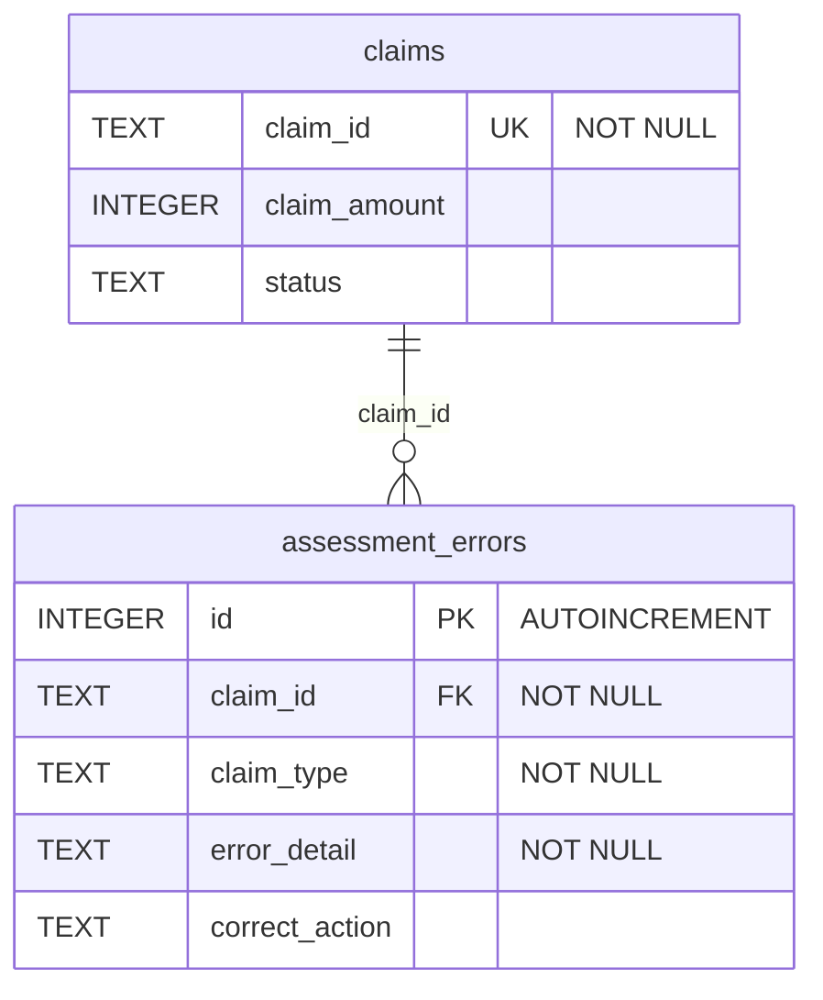

# 給付金データ管理・分析システム

## 概要

Python・SQLite・FastAPIを使用した、給付金データの
管理・検索・統計分析および査定誤り事例管理システムです。

CSVデータの取り込みから、データベースへの保存、
APIによる検索・集計・登録、自動テストまでを実装しました。

## 開発背景

生命保険会社における給付金支払査定業務では、
保険契約や支払基準に基づき、正確かつ効率的に
支払可否を判断することが求められます。

現職では、査定誤りの再発防止を目的として、
案件番号・案件種別・誤りの内容・正しい対応などを
Excelで個人的に管理し、類似案件の対応時に活用していました。

この経験をもとに、給付金データと査定誤り事例を
データベースで関連付けて管理し、必要な情報を
効率的に取得できるシステムを開発しました。

## 解決したい課題とアプローチ

| 課題 | 解決方法 |
|---|---|
| 過去の査定誤り事例を探す手間 | 案件種別による検索機能 |
| 給付金情報と誤り事例の個別確認 | INNER JOINによる関連情報の取得 |
| データの重複や不整合 | UNIQUE制約・外部キー制約・UPSERT |
| 給付金データの集計作業 | SQLによる自動集計・統計分析 |
| プログラムの変更に伴う不具合 | pytestによる自動テスト |

本システムを通じて、査定業務の正確性向上と
過去の誤りの再発防止を支援することを目指しています。

※ 本システムは個人学習用の成果物です。
実際の顧客情報や社内データは使用しておらず、
実務への導入や効果測定も行っていません。

## 使用技術・技術選定理由

| 技術 | 使用目的・選定理由 |
|---|---|
| Python | CSV処理・データベース操作・API開発を一つの言語で実装でき、データ処理にも適しているため |
| SQLite | データベースサーバーの構築が不要で、小規模なシステムの開発・検証に適しているため |
| SQL | データの検索・集計・結合をデータベース側で効率的に処理するため |
| FastAPI | PythonでREST APIを構築でき、Swagger UIによる動作確認も容易なため |
| Pydantic | APIへの入力データの型や必須項目を検証するため |
| pytest | 正常系・異常系の動作を自動で検証し、機能追加や修正に伴う不具合を検出するため |
| Git / GitHub | ソースコードの変更履歴を管理し、開発過程を記録するため |

本システムでは、CSVデータの取り込みから
データベース設計、API開発、自動テストまでの
一連の開発工程を経験することを重視して技術を選定しました。

また、小規模な個人開発であることを考慮し、
現時点ではSQLiteを採用しています。

## 主な機能

### データ取り込み・管理
- CSVファイルから給付金データを読み込む
- SQLiteデータベースにデータを保存する
- UNIQUEインデックスによる案件番号の重複防止
- UPSERTによる既存データの更新・新規データの登録
- 外部キー制約によるテーブル間のデータ整合性の維持

### データ検索・統計分析
- 支払状況別の件数・合計金額の集計
- 支払状況・最低金額を指定した給付金データの検索
- 請求件数・平均金額・最大金額・最小金額の集計
- 支払済件数の割合の算出

### 査定誤り事例管理
- 査定誤り事例の登録・保存
- 案件種別を指定した過去の査定誤り事例の検索
- 存在しない案件番号に対する登録の防止
- INNER JOINによる給付金データと査定誤り事例の結合

### API・品質管理
- FastAPIによる検索・集計・登録APIの提供
- Pydanticなどによる入力データのバリデーション
- トランザクション・rollbackによるデータ保護
- 正常時・異常時のデータベース接続終了処理
- pytestによる正常系・異常系の自動テスト18件

## ファイル構成

### メイン処理・API

| ファイル名 | 役割 |
|---|---|
| main.py | テーブル作成・CSV取り込み・集計処理の一括実行 |
| import_csv.py | UPSERTによる給付金データの登録・更新 |
| analysis.py | SQLによる支払状況別の集計 |
| api.py | FastAPIによる検索・集計・登録API |

### データベース管理・査定誤り事例管理

| ファイル名 | 役割 |
|---|---|
| create_errors_table.py | テーブル作成・UNIQUEインデックス・外部キー制約の設定 |
| insert_errors.py | 架空の査定誤り事例の登録 |
| search_errors.py | 案件種別による査定誤り事例の検索 |
| join_errors.py | INNER JOINによる給付金情報と査定誤り事例の結合 |
| add_foreign_key.py | 既存テーブルへの外部キー制約の追加（移行用） |
| check_foreign_key.py | 外部キー制約の動作確認 |

### 自動テスト

| ファイル名 | 役割 |
|---|---|
| test_api.py | APIの正常系・異常系テスト（16件） |
| test_database.py | 外部キー制約・UPSERTのテスト（2件） |

### その他

| ファイル名 | 役割 |
|---|---|
| kyufukin_sample.csv | 架空の給付金データ50件 |
| result.csv | CSV集計結果のサンプル |
| requirements.txt | 必要なライブラリの一覧 |
| README.md | システムの概要・設計・実行方法の説明 |

## 実行方法

### 動作環境

- Python 3
- Git（GitHubから取得する場合）

### 1. リポジトリの取得

```bash
git clone https://github.com/akamine-shun/hello-world.git
cd hello-world
```

### 2. 必要なライブラリのインストール

```bash
python3 -m pip install -r requirements.txt
```

### 3. データベースの構築・給付金データの登録

```bash
python3 main.py
```

以下の処理が順番に実行されます。

- データベース・テーブルの作成
- UNIQUEインデックス・外部キー制約の設定
- CSVから給付金データ50件を登録
- 支払状況別の件数・合計金額を集計

給付金データの登録にはUPSERTを使用しているため、
再実行しても同一案件番号のデータは重複せず、
既存データが更新されます。

### 4. 査定誤りサンプル事例の登録

```bash
python3 insert_errors.py
```

架空の査定誤り事例を登録します。

※ 同じ事例の重複登録を防ぐため、
このコマンドは初回のみ実行してください。

### 5. APIの起動

```bash
python3 -m uvicorn api:app --reload
```

起動後、ブラウザで以下にアクセスします。

http://127.0.0.1:8000/docs

Swagger UIから各APIの動作を確認できます。

### 6. 自動テストの実行

APIの起動中にテストを実行する場合は、
別のターミナルを開いて実行してください。
APIを起動していない状態でもテストは実行可能です。

```bash
python3 -m pytest -v
```

APIの正常系・異常系、外部キー制約、
UPSERTを含む計18件の自動テストを実行します。

### 補足

add_foreign_key.pyは既存データベースへの
外部キー制約追加を目的とした移行用スクリプトです。

新規環境ではmain.pyの実行時に外部キー制約が
設定されるため、実行する必要はありません。

### APIの機能

- GET /summary：支払状況別の件数・合計金額を取得
- GET /claims：支払状況・最低金額を指定して検索
- GET /statistics：請求件数・平均金額などの統計情報を取得
- GET /errors：案件種別を指定して査定誤り事例を検索
- POST /errors：新しい査定誤り事例を登録
- GET /errors/details：給付金情報と査定誤り事例を結合して取得
- GET /：ホームAPIの動作確認

## エラー処理・データ整合性

### 入力チェック・APIのエラー処理

- 支払状況の指定値を制限し、不正な検索条件を防止
- 最低金額に負の値を指定した場合はHTTP 422を返す
- 登録時に必須項目が不足している場合はHTTP 422を返す
- 存在しない案件番号を指定した場合はHTTP 404を返す
- データベースエラーが発生した場合はHTTP 500を返す
- プレースホルダーを使用し、SQLインジェクション対策を実施

### データ整合性を維持するための設計

| 実装内容 | 目的 |
|---|---|
| UNIQUEインデックス | 給付金テーブルにおける案件番号の重複を防止 |
| 外部キー制約 | 存在しない案件番号に紐づく査定誤り事例の登録を防止 |
| UPSERT | 新規データの登録と既存データの更新を両立 |
| トランザクション | 複数のデータ変更処理を一つの処理単位として管理 |
| commit | 正常に完了したデータ変更を確定 |
| rollback | エラー発生時に未確定のデータ変更を取り消す |

### データベース接続・例外処理

try・except・finallyを使用して、
データベース操作時の例外処理を実装しました。

データ変更処理では、エラー発生時にrollbackを行い、
途中までの変更が確定されることを防止しています。

また、finallyを使用することで、
正常時・異常時ともにデータベース接続を終了する
構成としています。

### UPSERTを採用した理由

当初は、既存の給付金データを削除してから
CSVデータを再登録する構成としていました。

しかし、外部キー制約の導入後は、
査定誤り事例が参照している給付金データを
削除できない場合があります。

そこで、案件番号を基準としたUPSERTを採用し、
既存データを削除せずに更新する構成へ変更しました。

これにより、査定誤り事例との関連性を維持しながら、
CSVデータの再取り込みが可能になりました。

## 自動テスト

pytestとFastAPIのTestClientを使用して、
APIおよびデータベースの動作を検証しています。

### APIのテスト（16件）

| テスト対象 | 検証内容 |
|---|---|
| ホームAPI | 正常動作 |
| 集計API | 正常動作 |
| 検索API | 正常動作 |
| 検索API | 不正な金額に対する422エラー |
| 統計分析API | 正常動作 |
| 統計分析API | DB接続エラー（500） |
| 集計API | DB接続エラー（500） |
| 検索API | DB接続エラー（500） |
| 査定誤り検索API | 正常動作 |
| 査定誤り検索API | DB接続エラー（500） |
| 査定誤り登録API | 正常動作（201） |
| 査定誤り登録API | 存在しない案件番号の登録エラー（404） |
| 査定誤り登録API | 必須項目の不足による入力エラー（422） |
| 査定誤り登録API | DB接続エラー（500） |
| 査定誤り詳細情報取得API | 正常動作（200） |
| 査定誤り詳細情報取得API | DB接続エラー（500） |

### データベースのテスト（2件）

| テスト対象 | 検証内容 |
|---|---|
| 外部キー制約 | 存在しない案件番号に紐づく査定誤り事例の登録が拒否されること |
| UPSERT | CSVの再取り込み時にデータ件数が増加せず、既存データが更新されること |

### テスト設計の工夫

- 正常系と異常系の両方を検証
- モックを使用してDB接続エラーを再現
- モックを使用して実際のDBを変更せずにAPIの登録処理を検証
- 一時ディレクトリにテスト用DBを構築し、外部キー制約とUPSERTを検証
- データベースのテストが通常利用するDBに影響しないように分離

### テスト結果

APIテスト16件、データベーステスト2件の
計18件の自動テストを実装し、
すべてのテストが成功することを確認しました。

```text
18 passed
```

### 実行コマンド

```bash
python3 -m pytest -v
```

※ APIの正常系テストには初期データを使用するものがあるため、
実行方法に記載したデータベースの準備を行ってから
テストを実行してください。

## 統計分析API

`GET /statistics`

給付金請求データ全体を対象に、SQLで統計情報を集計するAPIです。

### 取得できる情報

- 全体の請求件数
- 平均請求金額
- 最大請求金額
- 最小請求金額
- 支払済件数の割合

### 実行例

```json
{
  "total_claims": 50,
  "average_amount": 376660.0,
  "max_amount": 2700000,
  "min_amount": 5000,
  "paid_rate": 0.78
}
```

### 工夫した点

SQLの集計関数（COUNT、AVG、MAX、MIN、SUM）を使用し、
複数の統計情報を1回のSQL実行で取得できるようにしました。

また、請求データが0件の場合でも、
ゼロ除算が発生しないように処理しています。

## システム構成

```text
給付金サンプルデータ（CSV）
          |
          v
     import_csv.py
      CSV読み込み
          |
          v
   SQLite（kyufukin.db）
      データ保存
          ^
          | SQLによる検索・集計
          v
    api.py（FastAPI）
          ^
          | HTTPリクエスト・レスポンス
          v
  ブラウザ（Swagger UI）
```

### データ処理の流れ

1. CSVファイルから給付金請求データを読み込む
2. PythonでSQLiteデータベースに保存する
3. FastAPIからSQLを実行して検索・集計する
4. 集計結果をJSON形式で返す
5. ブラウザからAPIの動作を確認する

## データベース設計

本システムでは、給付金データと査定誤り事例を
それぞれ独立したテーブルで管理しています。

### ER図



### claims（給付金テーブル）

| カラム名 | データ型 | 制約 | 内容 |
|---|---|---|---|
| claim_id | TEXT | NOT NULL・UNIQUEインデックス | 案件番号 |
| claim_amount | INTEGER | なし | 請求金額 |
| status | TEXT | なし | 支払状況 |

### assessment_errors（査定誤り管理テーブル）

| カラム名 | データ型 | 制約 | 内容 |
|---|---|---|---|
| id | INTEGER | PRIMARY KEY・AUTOINCREMENT | 事例管理ID |
| claim_id | TEXT | NOT NULL・FOREIGN KEY | 案件番号 |
| claim_type | TEXT | NOT NULL | 案件種別 |
| error_detail | TEXT | NOT NULL | 査定誤り内容 |
| correct_action | TEXT | なし | 正しい対応・確認事項 |

### テーブル間の関連性

claimsとassessment_errorsは、
claim_idを使用して関連付けています。

1件の給付金データに対して複数の査定誤り事例を
登録できる、1対多の関係です。

給付金テーブルのclaim_idにはUNIQUEインデックスを
設定し、案件番号の重複を防止しています。

また、査定誤り管理テーブルのclaim_idには
外部キー制約を設定し、存在しない案件番号に
紐づく事例の登録を防止しています。

### テーブルを分離した理由

給付金データと査定誤り事例を別々のテーブルで
管理することで、同一案件に複数の誤り事例が
存在する場合でも、給付金情報を重複して
保存する必要がなくなります。

必要に応じてINNER JOINを使用することで、
給付金情報と査定誤り事例をまとめて取得できます。

### 設計上の工夫

- UNIQUEインデックスによる案件番号の一意性の確保
- 外部キー制約による参照整合性の維持
- 主キーによる個々の査定誤り事例の識別
- テーブルの分離による給付金情報の重複保存の抑制
- UPSERTによる既存データと関連情報の維持

※ 上記は新規環境で作成されるテーブルの定義です。

## 査定誤り事例管理機能

### 管理する情報

- 案件番号
- 案件種別
- 査定誤り内容
- 正しい対応・確認事項

### 査定誤り検索API

`GET /errors`

案件種別を指定すると、該当する査定誤り事例を取得します。

検索例：

`GET /errors?claim_type=入院給付金`

レスポンス例：

```json
{
  "errors": [
    {
      "claim_id": "C001",
      "claim_type": "入院給付金",
      "error_detail": "入院日数の計算誤り",
      "correct_action": "支払対象日数を再確認する"
    }
  ]
}
```

### 査定誤り登録API

`POST /errors`

新しい査定誤り事例をAPIから登録します。

リクエスト例：

```json
{
  "claim_id": "C003",
  "claim_type": "入院給付金",
  "error_detail": "支払対象日数の確認漏れ",
  "correct_action": "診断書と入院期間を照合する"
}
```

レスポンス例（HTTP 201）：

```json
{
  "message": "査定誤りの事例を登録しました"
}
```

### 登録時の処理

1. Pydanticで入力データの形式を確認する
2. SQLで案件番号が存在するか確認する
3. INSERT文で査定誤り事例を登録する
4. commitで登録内容を確定する
5. 登録結果をJSON形式で返す

### HTTPステータスコード

| ステータスコード | 内容 |
|---|---|
| 201 | 登録成功 |
| 404 | 案件番号が存在しない |
| 422 | 必須項目の不足などの入力エラー |
| 500 | データベースエラー |

### 査定誤り詳細情報取得API

`GET /errors/details`

SQLのINNER JOINを使用して、給付金テーブル（claims）と
査定誤り管理テーブル（assessment_errors）を案件番号で結合します。

給付金情報と査定誤り事例を一度のAPIリクエストで取得できます。

レスポンス例：

```json
{
  "details": [
    {
      "claim_id": "C001",
      "claim_amount": 56000,
      "status": "審査中",
      "claim_type": "入院給付金",
      "error_detail": "入院日数の計算誤り",
      "correct_action": "支払対象日数を再確認する"
    }
  ]
}
```

INNER JOINを使用しているため、両方のテーブルで
案件番号が一致するデータのみを取得します。

### 工夫した点

- 案件種別を指定することで類似事例を検索可能にした
- API側の案件番号の存在確認とDB側の外部キー制約により、不正な参照を防止
- INNER JOINを使用し、給付金情報と査定誤り事例を一度に取得できるようにした

### 期待される効果

過去の査定誤り事例を案件種別から検索できるため、
類似案件の確認に必要な情報を探しやすくなります。

これにより、過去の誤りの再発防止や
査定業務の正確性向上を支援することを目指しています。

なお、実際の業務に導入して効果を測定したものではありません。

## 今後の改善課題

現時点では、小規模な個人開発として、
データ管理・API開発・データ整合性・自動テストを
中心に実装しています。

今後の拡張に向けて、以下の改善を検討しています。

| 改善項目 | 目的 |
|---|---|
| PostgreSQLへの移行 | データ量の増加や複数ユーザーによる利用への対応 |
| データベース接続処理の共通化 | コードの重複削減と保守性の向上 |
| 処理の関数化・モジュール化 | 再利用性と可読性の向上 |
| 検索条件の拡充 | 類似する査定誤り事例の検索精度向上 |
| 査定誤り事例の更新・削除機能 | 登録済み事例の管理機能の拡充 |
| 認証・アクセス制御 | データへの不正アクセスの防止 |
| 自動テストの拡充 | 境界値やrollback処理などの検証 |
| Dockerによる環境構築 | 実行環境の再現性向上 |
| GitHub Actionsの導入 | コード変更時の自動テスト実行 |

今後は、機能の拡充だけでなく、
保守性・拡張性・セキュリティも考慮した
システム設計について理解を深めていきたいと考えています。